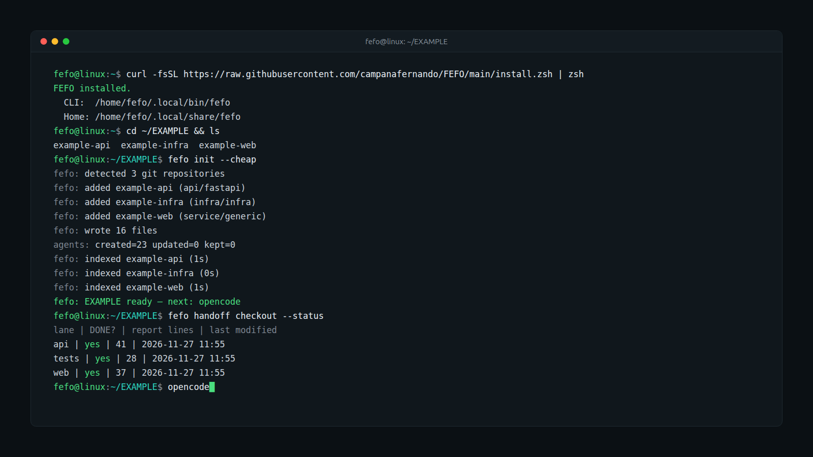

# FEFO



FEFO is a thin federation layer for OpenCode: one zsh CLI that writes a
workspace's root instructions (`AGENTS.md`), OpenCode config (`opencode.json`),
a markdown vault, and CodeGraph wiring for sibling repositories. The
orchestration method lives in `AGENTS.md`, so any OpenCode session follows it
with no FEFO agent, plugin, mode, or slash command.

## Requirements

- zsh 5.8+ on Linux or macOS
- git
- OpenCode 2.4.2+ (latest)
- Recommended, detected by `fefo doctor`: `codegraph` CLI, `browse` (browser
  MCP), ponytail plugin, caveman skill.
- CodeGraph needs no Node: `curl -fsSL https://raw.githubusercontent.com/colbymchenry/codegraph/main/install.sh | sh`;
  upgrade with `codegraph upgrade`.

## Install

```sh
curl -fsSL https://raw.githubusercontent.com/campanafernando/FEFO/main/install.zsh | zsh
```

Or in a clone:

```sh
zsh install.zsh
```

Flags: `--dir`, `--ref`, `--cheap`, `--model`, `--fallback`,
`--ai-agents`/`--default-agents`, `--yes`, `--with-all`, `--uninstall`.
Interactive by default: pick cheap (strongest free model) or default (search
and pick any OpenCode model), plus optional CodeGraph, browse, ponytail, caveman.

## Quick start

```sh
mkdir -p ~/work && cd ~/work
git clone <api-url> api && git clone <web-url> web
fefo init        # scans api/ and web/, asks cheap or default, indexes
opencode         # then: "act as orchestrator: <spec>"
```

`fefo init` scans children and siblings (or takes `--repo PATH`). OpenCode reads
project config only inside a Git repository, so `init` runs `git init` when the
workspace is not one and keeps nested repos out of it via `.gitignore`.

## Model modes

- `cheap` (default): at dispatch, pick the strongest free OpenCode model and
  pin it on every subagent call; keep the next two strongest free models as
  the ladder.
- `default`: pin one model you pick on every subagent call.
- Automatic fallback is always on: on a usage/rate/provider error, resume the
  same session on the sibling provider, then the strongest other free model,
  then your own model (or the configured fallback).
- Variant/effort is never asked: `AGENTS.md` tells the orchestrator to use the
  highest variant automatically.

Set with `fefo model cheap|default`, or interactively during `fefo init`.

## Commands

| Command | Purpose |
|---|---|
| `fefo init` | create manifest, sync, index |
| `fefo add PATH` | add a repository |
| `fefo remove NAME` | remove a repository |
| `fefo sync [--check]` | regenerate managed files |
| `fefo status` | workspace overview |
| `fefo index [NAME...]` | refresh CodeGraph indexes |
| `fefo index --vault` | rebuild the vault graph |
| `fefo doctor` | validate workspace and tools |
| `fefo mcp list\|add\|remove` | manage MCP servers |
| `fefo model ...` | show/set subagent policy |
| `fefo handoff TASK LANE...` | create handoff directory |
| `fefo graph` | open the know-graph viewer |
| `fefo agents` | install default or AI-scoped agents |
| `fefo version`, `fefo help` | |

## Workspace files

Generated (rewritten by `fefo sync`): `opencode.json`, `AGENTS.md`,
`docs/vault/*`, `codegraph/README.md`, launchers, and (when `claude on`)
`CLAUDE.md`, `.mcp.json`, `.claude/skills/*`.

Yours (never overwritten): `AGENTS.local.md`, `docs/vault/decisions.md`,
`.env`, `.env.mcp`, `opencode.jsonc`, `.opencode/opencode.json`. OpenCode
merges the user-owned config after `opencode.json`; FEFO never touches it.

The manifest is `.fefo/workspace.zsh`. User defaults live in
`${XDG_CONFIG_HOME:-$HOME/.config}/fefo/config.zsh`.

## Handoff protocol

`fefo handoff <task> <lane>...` creates `<handoff-root>/<task>/` (mode 700)
with `README.md` (targets, rules, decisions, lane table) and lane dirs. Default
handoff root: `/var/tmp/fefo/<ws-slug>/<task>`. Each lane writes `report.md`,
then an empty `DONE`; `fefo handoff <task> --status` shows which lanes are done.
Resume stopped subagents by session id.

## CodeGraph, vault graph, know-graph

- CodeGraph: one server (`codegraph`); pass absolute `projectPath`. Refresh
  indexes first: `fefo index`.
- Vault: Markdown is not a CodeGraph language. A separate `vault` server
  (served with `--no-watch`) exposes notes; rebuild with `fefo index --vault`.
- know-graph: `fefo graph` renders the vault graph in a local browser page.

## Agents

`fefo agents` installs either the default copied set (offline, recommended) or
AI-scoped agents generated by one OpenCode job. Only `codegraph` and
`vault-search` skills ship. Subagents are `mode: subagent` with no model pin.

## Bonus shell functions

`share/fefo.zsh` provides `cmg` (commit message from staged diff), `bng`
(branch name from diff), `doit` (run a task with `opencode run`). Sourced from
`~/.zshrc` by the installer.

## Using Claude

Recommended: OpenCode plus the Claude Agent integration. Run `opencode auth
login`, pick "Claude Agent"; it reuses your Claude Code login, so a Claude
subscription works inside OpenCode with no OpenCode plan. The OpenCode Go plan
is strongly recommended for cheap workers and higher free-model limits.

Claude Code CLI works directly too: FEFO generates `CLAUDE.md`,
`.mcp.json`, and `.claude/skills/` when `claude on` (default). This is basic
support — no OpenCode model pinning; subagents run on Claude models.

## Upgrading from Python FEFO

Re-run `fefo init --force` in the workspace. Python FEFO is retired. Removed:
Python CLI and tests, Cursor/Copilot adapters, old `.claude` agents/commands/
settings wrappers, slash commands, the `fefo` primary agent and "mode", the
`opencode-fefo` plugin and its "fefo" permission action, Windows/PowerShell
paths. Kept: the orchestration method (now in `AGENTS.md`), CodeGraph per
repo, the vault, and `cmg`/`bng`/`doit`. Basic Claude Code CLI support
(`CLAUDE.md`, `.mcp.json`, `.claude/skills`) is added.