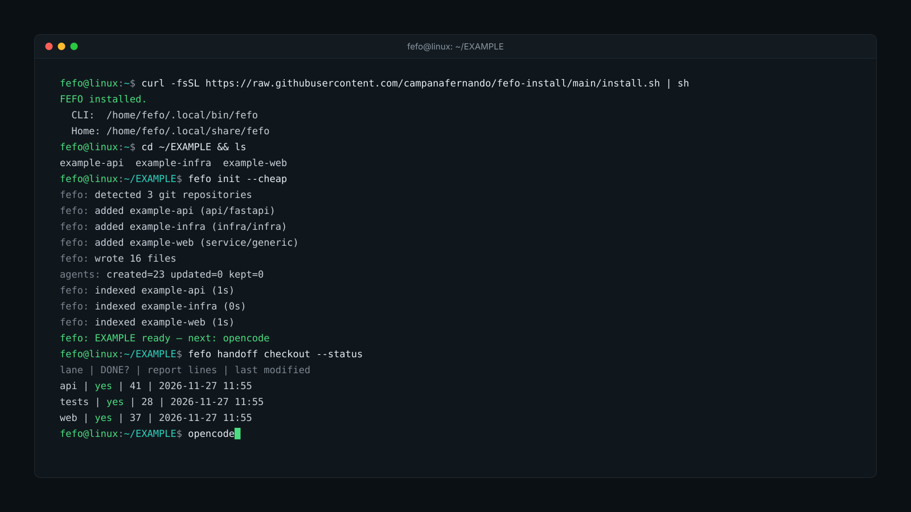

# FEFO



FEFO is a thin federation layer for OpenCode: one zsh CLI that writes a
workspace's root instructions (`AGENTS.md`), OpenCode config (`opencode.json`),
a markdown knowledge vault, generated per-repo code vaults, and a FEFO graph
over both. The orchestration method lives in
`AGENTS.md`, so any OpenCode session follows it with no FEFO agent, plugin, or
slash command.

## Requirements

- zsh 5.8+ on Linux or macOS
- git
- OpenCode, latest (minimum 2.4.2)
- Recommended, detected by `fefo doctor`: `browse` (browser MCP), ponytail
  plugin, caveman skill.

## Install

Install built in: one line, no clone.

```sh
curl -fsSL https://raw.githubusercontent.com/campanafernando/FEFO/main/install.sh | sh
```

Installs the `fefo` CLI (bin link into `~/.local/bin`), the cmg/bng/doit shell helpers
(`~/.local/share/fefo/share/fefo.zsh`, sourced from `~/.zshrc`), and opt-in OpenCode
components (browse, ponytail, caveman). Flags: `--dir`, `--ref`, `--cheap`, `--model`,
`--fallback`, `--yes`, `--with-all`, `--uninstall`, `--from`, `--ai-agents`, `--default-agents`;
env: `FEFO_INSTALL_TARBALL`, `FEFO_INSTALL_DRY`, `FEFO_REF`.

Uninstall:

```sh
curl -fsSL https://raw.githubusercontent.com/campanafernando/FEFO/main/install.sh | sh -s -- --uninstall
```

## Quick start

```sh
mkdir -p ~/work && cd ~/work
git clone <api-url> api && git clone <web-url> web
fefo init        # scans api/ and web/, asks cheap or default, builds vaults + graph
opencode         # then: "act as orchestrator: <spec>"
```

`fefo init` scans children and siblings (or takes `--repo PATH`). OpenCode reads
project config only inside a Git repository, so `init` runs `git init` when the
workspace is not one and keeps nested repos out of it via `.gitignore`.

## Model modes

- `cheap` (default): at dispatch, pick the strongest free OpenCode model and
  pin it on every subagent call; keep the next two strongest free models as
  the ladder.
- `default`: pin one model you pick on every subagent call.
- Automatic fallback is always on: on a usage/rate/provider error, resume the
  same session on the sibling provider, then the strongest other free model,
  then your own model (or the configured fallback).
- Variant/effort is never asked: `AGENTS.md` tells the orchestrator to use the
  highest variant automatically.

Set with `fefo model cheap|default`, or interactively during `fefo init`.

## Commands

| Command | Purpose |
|---|---|
| `fefo init` | create manifest, sync, build code vaults + graph |
| `fefo add PATH` | add a repository |
| `fefo remove NAME` | remove a repository |
| `fefo sync [--check]` | regenerate managed files |
| `fefo status` | workspace overview |
| `fefo vault [--changed] [NAME...]` | regenerate per-repo code vaults + `docs/vault/graph.json` |
| `fefo doctor` | validate workspace and tools |
| `fefo mcp list\|add\|remove` | manage MCP servers |
| `fefo model ...` | show/set subagent policy |
| `fefo handoff TASK LANE...` | create handoff directory |
| `fefo graph [--query TERM] [--out FILE]` | query the vault graph or open the viewer |
| `fefo agents` | install default or AI-scoped agents |
| `fefo version`, `fefo help` | |

## Workspace files

Generated (rewritten by `fefo sync`): `opencode.json`, `AGENTS.md`,
`docs/vault/*`, launchers, and (when `claude on`)
`CLAUDE.md`, `.mcp.json`, `.claude/skills/*`. Per-repo code vaults
(`docs/vault/<slug>-vault/`, written by `fefo vault`) and
`docs/vault/graph.json` are generated and gitignored.

Yours (never overwritten): `AGENTS.local.md`, `docs/vault/decisions.md`,
`.env`, `.env.mcp`, `opencode.jsonc`, `.opencode/opencode.json`. OpenCode
merges the user-owned config after `opencode.json`; FEFO never touches it.

The manifest is `.fefo/workspace.zsh`. User defaults live in
`${XDG_CONFIG_HOME:-$HOME/.config}/fefo/config.zsh`.

## Handoff protocol

`fefo handoff <task> <lane>...` creates `<handoff-root>/<task>/` (mode 700)
with `README.md` (targets, rules, decisions, lane table) and lane dirs. Default
handoff root: `/var/tmp/fefo/<ws-slug>/<task>`. Each lane writes `report.md`,
then an empty `DONE`; `fefo handoff <task> --status` shows which lanes are done.
Resume stopped subagents by session id.

## Code vaults

`fefo vault` writes one generated code vault per repo (vault on by default;
per-repo `vault=off`) to `docs/vault/<slug>-vault/`:

- `00-INDEX.md`: one-line role per module, entry points, manifest commands,
  how to use;
- `modules/<m>.md`: role, files, top-level definitions `path — Name:line`,
  routes, models, `[[modules/x]]` import edges, `Used by` importers;
- `recent.md`: last 20 commits with per-module file counts.

Vault-first + scoped grep: read the index → module note → `path:line`, then
verify usages with `git -C <repo> grep -n` only inside the listed files; never
grep a whole repo before reading its index. Source is `git ls-files`;
tests/migrations are skipped.

Auto refresh: `fefo vault --changed` runs at session start (unchanged repos
cost ~0); long sessions can add an OpenCode automation (shell, every 30
minutes) running `fefo vault --changed`. Code vaults are generated and
gitignored (`/docs/vault/*-vault/`); `fefo vault` after edits refreshes them.

## FEFO graph

`fefo graph --query <term>` searches symbols, modules, routes, commits and
notes in `docs/vault/graph.json` (labels and paths, case-insensitive; exact and
prefix matches first, cap 20) and prints `kind`, label and `path:line`. The
graph is built from every vault Markdown file by `fefo vault` and refreshed by
`fefo vault --changed`. `fefo graph` alone opens the same graph in a local
viewer; `--out FILE` writes the HTML only.

## Agents

`fefo agents` installs either the default copied set (offline, recommended) or
AI-scoped agents generated by one OpenCode job. Only the `vault-search` skill
ships. Subagents are `mode: subagent` with no model pin.

## Using Claude

Recommended: OpenCode plus the Claude Agent integration. Run `opencode auth
login`, pick "Claude Agent"; it reuses your Claude Code login, so a Claude
subscription works inside OpenCode with no OpenCode plan. The OpenCode Go plan
is strongly recommended for cheap workers and higher free-model limits.

Claude Code CLI works directly too: FEFO generates `CLAUDE.md`,
`.mcp.json`, and `.claude/skills/` when `claude on` (default). This is basic
support — no OpenCode model pinning; subagents run on Claude models.
